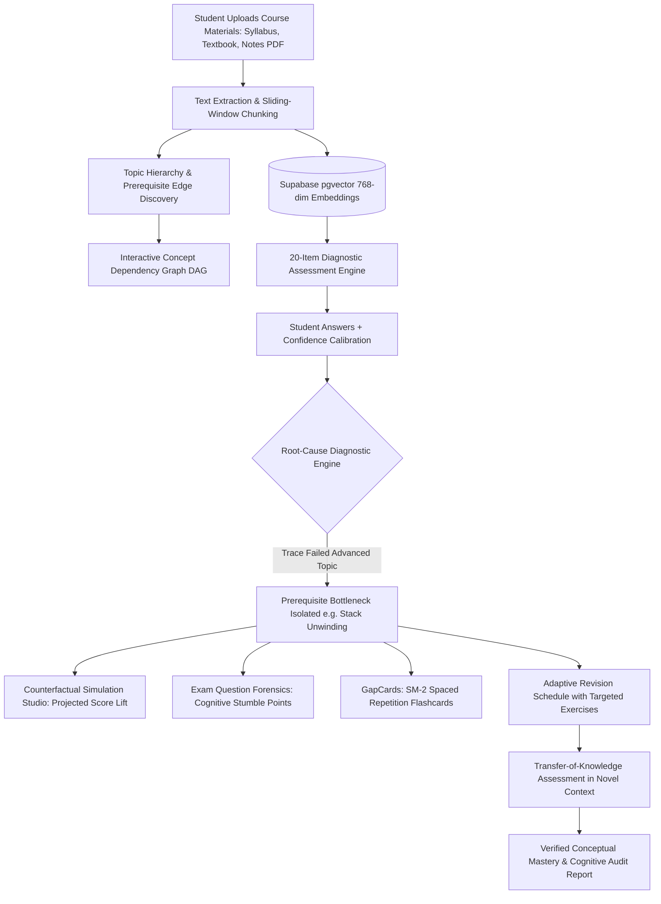

# GapFinder AI (SkillBlind AI)
### Empirical Cognitive Knowledge Gap Detection, Root-Cause Prerequisite Isolation & Adaptive Learning Intelligence

[](https://nextjs.org/)
[](https://react.dev/)
[](https://www.typescriptlang.org/)
[](https://supabase.com/)
[](https://deepmind.google/technologies/gemini/)
[](#)

> **"Students often study everything equally and still miss what they don't know. Most study tools wait for the student to ask a question, but a student cannot ask about a gap they don't know they have. GapFinder AI takes a student's syllabus, textbook chapters, notes, and past question papers, isolates foundational weak areas, and builds a personalized revision plan. Chat can support the experience, but the main output is a rigorous diagnosis, not just answers."**

---

## 🚀 Live Repository Navigation

The complete Next.js production web application is structured inside the [`skillblind-ai/`](./skillblind-ai) directory:

```bash
# Clone the repository
git clone https://github.com/vangalalavakumarlavakumar-web/Skill-Blind-AI.git

# Enter application directory
cd Skill-Blind-AI/skillblind-ai

# Install dependencies
npm install

# Launch local development server
npm run dev
```

Open [**http://localhost:3000**](http://localhost:3000) to access the interactive web interface.

---

## 🌟 What Makes GapFinder AI Different?

Traditional revision tools rely on flat percentage scores (e.g., *"Student scored 25% on Tree Traversal"*). However, a student struggling with Tree Traversal usually does not have a "Tree" problem—they have a foundational prerequisite failure in **Call Stack Frame Unwinding** during recursion.

| Capability | Generic Study Tools | GapFinder AI |
| :--- | :--- | :--- |
| **Weakness Detection** | Surface quiz scores (e.g., 25% on Trees) | **Root-Cause Isolation** (traces errors back through prerequisite DAG) |
| **Curriculum Modeling** | Flat lists of topics | **Directed Concept Dependency Graph (DAG)** with bottleneck detection |
| **Prerequisite Ripple Simulation** | None (Static scores) | **Counterfactual Gap Simulation Studio** (interactive ROI levers) |
| **Exam Problem Analysis** | Generic chat answers | **Exam Question Forensics** (step-by-step cognitive vulnerability trace) |
| **Retention & Recall** | Passive text notes | **GapCards SM-2 Spaced Repetition** targeted at student misconceptions |
| **Mental Model Diagnosis** | Ignored | **Confidence Calibration** (catches confident but incorrect answers) |
| **Mastery Verification** | Retesting with identical questions | **Transfer of Knowledge Testing** in novel, unfamiliar contexts |
| **Material Grounding** | Web search / hallucinated text | **Source-Grounded RAG** with page and line citations |

---

## 🎓 5 Supported University Core Subjects (100 Rigorous Diagnostic Items)

GapFinder AI comes preloaded with comprehensive 20-item diagnostic assessments tailored for 5 engineering college core subjects:

1. **Data Structures & Algorithms (`CS201`)**
   - *Key Focus*: Recursion Call Stacks & Activation Records, Trees (DFS/BFS), Binary Search Trees, Heaps, Graph Algorithms, Dynamic Programming.
2. **Database Management Systems (`CS301`)**
   - *Key Focus*: ACID Properties & Anomalies, Relational Normalization (1NF to BCNF), B+ Tree Storage Indexing, SQL Joins, Concurrency Control (2PL), Write-Ahead Logging (WAL).
3. **Operating Systems (`CS302`)**
   - *Key Focus*: Process/Thread Scheduling (CFS, MLFQ), Semaphores & Critical Section Mutual Exclusion, Virtual Memory & Page Replacement (LRU), Deadlocks (Banker's Algorithm), Inode File Systems.
4. **Computer Networks (`CS401`)**
   - *Key Focus*: OSI & TCP/IP Reference Layers, TCP 3-Way Handshake & Congestion Control (Reno/Cubic), IPv4/IPv6 CIDR Subnetting, Routing Protocols (OSPF, BGP), DNS & TLS Protocols.
5. **Machine Learning & AI (`CS501`)**
   - *Key Focus*: Supervised vs Unsupervised Paradigms, Bias-Variance Tradeoff, Gradient Descent Optimization & Learning Rates, L1 Lasso vs L2 Ridge Regularization, Classification Metrics (Precision/Recall/F1/ROC-AUC), CART Gini Impurity, Random Forests Bagging, Neural Backpropagation Chain Rule, ReLU Activation, SVM Kernels, K-Means Clustering Inertia.

---

## 🔬 Core System Architecture



---

## 💎 Exclusive Standout Features

### 1. Counterfactual Gap Simulation Studio (`/simulator`)
- Interactive mathematical simulator where students can toggle or drag target mastery on identified root-cause bottlenecks.
- Dynamically recalculates downstream prerequisite propagation through the DAG in real time.
- Computes the **Prerequisite Leverage Ratio** (e.g. *1 : 3.4*—each hour invested in the root gap unlocks 3.4 hours of advanced recovery) and projects the student's final exam score lift.

### 2. Exam Question & Past Paper Gap Forensics (`/forensics`)
- Upload or paste university exam problems.
- Deconstructs questions into constituent cognitive prerequisite steps (e.g. *Base Condition Formulation*, *Subtree Decomposition*, *Stack Frame Unwinding*).
- Predicts with pinpoint statistical accuracy exactly which step the student will fail and why.

### 3. GapCards — Spaced-Repetition Active Recall Deck (`/flashcards`)
- Auto-generates active recall cards targeting the student's isolated misconceptions.
- Features 3D card flips with textbook citations and the **SuperMemo SM-2** spaced repetition algorithm (`Again [1d]`, `Hard [2d]`, `Good [4d]`, `Easy [7d]`).

### 4. Live Supabase Backend & Database Status Monitor
- Probes live PostgreSQL database connectivity, latency (ms), and table accessibility across 24 core relational tables.
- **Dual-Mode Sync Architecture**: Runs locally with zero crashes and seamlessly mirrors diagnostic state to the Supabase cloud whenever credentials are provided.

---

## 🛠️ Technology Stack

- **Frontend**: Next.js 16 (App Router with Turbopack), React 19, TypeScript
- **Styling**: Tailwind CSS, Modern Academic Indigo/Navy UI, Lucide Icons
- **Database**: Supabase PostgreSQL with `pgvector` extension for 768-dim embeddings
- **AI & RAG**: Google Gemini 1.5 Flash + Heuristic Curriculum Diagnostic Fallback Engine
- **State Management**: Dual-Mode LocalStorage + Remote PostgreSQL Mirroring

---

## 📁 Repository Structure

```text
skillblind-ai/
├── src/
│   ├── app/
│   │   ├── (auth)/             # Login & Registration pages
│   │   ├── (dashboard)/
│   │   │   ├── dashboard/      # Main Student Dashboard & Metrics
│   │   │   ├── quiz/           # 20-Item Diagnostic Assessment (Multi-Subject)
│   │   │   ├── simulator/      # Counterfactual Gap Simulation Studio
│   │   │   ├── forensics/      # Exam Question Gap Forensics
│   │   │   ├── flashcards/     # GapCards Spaced Repetition Deck
│   │   │   ├── graph/          # Interactive Concept Dependency Graph
│   │   │   ├── diagnosis/      # Root-Cause Evidence Inspector
│   │   │   ├── predictions/    # Predictive Risk Modeling
│   │   │   ├── interventions/  # Adaptive Targeted Revision Plan
│   │   │   ├── transfer/       # Transfer-of-Knowledge Verification
│   │   │   ├── report/         # Comprehensive Gap Audit Report
│   │   │   ├── materials/      # Course PDF Upload & Chunking
│   │   │   ├── assistant/      # Grounded RAG AI Tutor
│   │   │   ├── analytics/      # Progress & Score Tracking
│   │   │   └── teacher/        # Cohort Heatmap for Instructors
│   │   ├── api/
│   │   │   ├── backend/        # Supabase Status, Sync & Config APIs
│   │   │   ├── quiz/           # Dynamic Subject Question API
│   │   │   ├── upload-pdf/     # PDF Parsing & Chunking API
│   │   │   └── assistant/      # Grounded RAG Chat API
│   ├── components/             # Reusable UI, Layout, Graph Canvas & Backend Modal
│   ├── lib/
│   │   ├── subject-question-banks.ts # 100 questions across 5 core subjects
│   │   ├── services/           # Diagnostic, Graph, Risk, and Supabase Services
│   │   └── storage.ts          # State Engine & LocalStorage Manager
│   └── types/                  # Complete TypeScript Interfaces
├── supabase/
│   ├── migrations/             # 20260101_init_skillblind.sql (24 tables + pgvector)
│   └── seed.sql                # Complete Demonstration Seed Data
└── package.json
```

---

## 👨‍💻 Project Information

- **Author**: Lava Kumar
- **Curriculum Domain**: Autonomous Engineering College Benchmark
- **Repository**: [https://github.com/vangalalavakumarlavakumar-web/Skill-Blind-AI](https://github.com/vangalalavakumarlavakumar-web/Skill-Blind-AI)
- **License**: MIT
