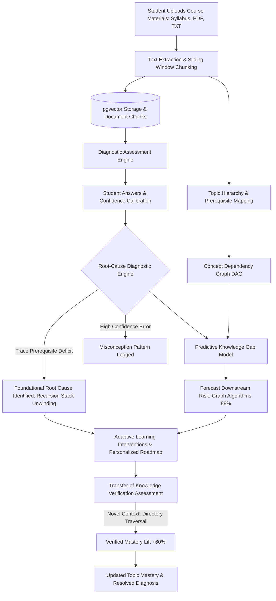

# SkillBlind AI
### Predictive Knowledge Gap Detection and Adaptive Learning Intelligence

> **"Find the Gap. Understand the Cause. Master the Concept."**

SkillBlind AI is an AI-powered personalized learning platform that identifies not only which topics students struggle with, but **why they struggle, which foundational prerequisite concepts they are missing, and what they should learn next.**

Unlike traditional learning platforms that merely aggregate quiz scores and suggest generic re-reading, SkillBlind AI constructs a **concept dependency graph**, traces errors back to **root causes**, forecasts **predictive knowledge gaps**, and verifies improvement through **novel transfer-of-knowledge assessments**.

---

## 1. Core Problem Statement

Traditional AI learning tools identify weak topics purely through score thresholds (e.g., *"Student scored 25% on Tree Traversal"*). However, failure in an advanced topic usually stems from:
1. **Missing prerequisite concepts** (e.g., inability to trace recursive base cases or stack unwinding).
2. **High-confidence misconceptions** (flawed mental models that students believe are correct).
3. **Lack of transferability** (memorizing past questions without understanding the governing principle).

SkillBlind AI uses students' uploaded course materials (syllabus, notes, textbook chapters, past exam papers) to construct an evidence-grounded cognitive diagnosis.

---

## 2. Core Differentiators

| Capability | Traditional Learning Platforms | SkillBlind AI |
| :--- | :--- | :--- |
| **Weakness Detection** | Surface quiz scores (e.g. 25% in Trees) | **Root-Cause Diagnosis** (Cascading from Recursion base cases) |
| **Curriculum Modeling** | Flat list of topics | **Directed Concept Dependency Graph (DAG)** with bottleneck detection |
| **Future Planning** | Reactive revision suggestions | **Predictive Learning-Risk Scoring** with explainable factor weights |
| **Student Mental Model** | Ignored | **Confidence Calibration** (High-Confidence error detection) |
| **Verification of Mastery** | Repeating identical quiz questions | **Transfer-of-Knowledge Testing** in unfamiliar application contexts |
| **Material Grounding** | Generic public web content | **RAG grounded strictly in uploaded student materials** with citations |

---

## 3. Technology Stack

- **Frontend Framework**: Next.js 15+ (App Router), React 19, TypeScript strict mode
- **Styling**: Tailwind CSS, Deep Navy/Indigo Design System, Lucide Icons, Recharts
- **Database & Vectors**: Supabase PostgreSQL, `pgvector` for 768-dim vector similarity search
- **Security & Isolation**: Supabase Auth, Row Level Security (RLS) policies per user
- **AI Models & RAG**: Google Gemini (`gemini-1.5-flash`), chunk sliding-window extraction, rubric keyword matching
- **Validation**: Zod schema validation
- **Testing**: Automated end-to-end test suite (`scripts/verify-logic.ts`)

---

## 4. System Architecture



---

## 5. Comprehensive 24-Table Database Schema

The database architecture is defined in `supabase/migrations/20260101_init_skillblind.sql`:

1. `profiles`: Student and teacher user records
2. `subjects`: Academic courses (e.g., CS201 Data Structures)
3. `study_materials`: Syllabus, textbooks, lecture notes
4. `document_chunks`: Extracted text chunks with `pgvector(768)` embeddings
5. `topics`: Subject concept nodes and difficulty hierarchy
6. `concept_dependencies`: Directed prerequisite graph edges with confidence and citations
7. `topic_source_mappings`: Source materials linking to topics
8. `quizzes`: Diagnostic quizzes
9. `quiz_questions`: Questions with rubrics, citations, and correct answers
10. `quiz_attempts`: Student attempt headers
11. `student_answers`: Verbatim student answers and time spent
12. `answer_evaluations`: Rubric scores, missing concepts, flaw indicators
13. `misconception_patterns`: High-confidence error clusters
14. `root_cause_diagnoses`: Observed issues vs. hypothesized foundational causes
15. `topic_mastery`: Mastery scores (Weak, Developing, Strong, Insufficient)
16. `learning_risk_predictions`: Downstream risk calculations and factors
17. `learning_interventions`: Prescribed remediation tasks
18. `revision_plans`: Scheduled learning roadmaps
19. `revision_tasks`: Daily scheduled items
20. `transfer_assessments`: Novel-context application tests
21. `chat_sessions`: RAG query sessions
22. `chat_messages`: Grounded messages with exact citations
23. `classes`: Teacher classroom extensions
24. `class_memberships`: Enrolled student associations

---

## 6. Preloaded Demonstration Dataset (CS201 Data Structures)

The repository comes preloaded with a complete benchmark dataset for demonstration and evaluation:

- **Subject**: Data Structures and Algorithms (`CS201`)
- **Concept Prerequisite Chain**:
  $$\text{Functions \& Scope} \longrightarrow \text{Recursion \& Call Stacks} \longrightarrow \text{Tree Traversal (DFS)} \longrightarrow \text{Binary Search Trees}$$
- **Observed Failure**: Student scores 25% on Binary Tree Traversal.
- **Root-Cause Diagnosis**: Student possesses a high-confidence misconception regarding recursive stack frame unwinding: *"Variables are wiped from memory and the computer starts again from the root."*
- **Prescribed Remediation**: Call stack tracing exercise on `factorial(3)` and 3-node trees.
- **Transfer Verification**: Evaluates recursion in a new application context: **hierarchical file system directory size calculation**, verifying a **+60% performance lift**.

---

## 7. Local Development & Installation

### Prerequisites
- Node.js 18+ (Node.js 20+ recommended)
- npm or pnpm

### Quick Start
```bash
# 1. Clone repository
git clone https://github.com/your-username/skillblind-ai.git
cd skillblind-ai

# 2. Install dependencies
npm install

# 3. Setup environment variables
cp .env.example .env.local

# 4. Run automated verification suite
npx tsx scripts/verify-logic.ts

# 5. Start development server
npm run dev
```

Open [http://localhost:3000](http://localhost:3000) to view the application.

---

## 8. Placement Drive / Judge Evaluation Guide

To demonstrate the full end-to-end diagnostic workflow:

1. **Launch Landing Page**: Navigate to [http://localhost:3000](http://localhost:3000) and review the value proposition, interactive graph preview, and case study.
2. **Instant Demo Access**: Click **"Explore Demo"** or navigate to `/login` and click **"Launch Demo Account (Alex Vance)"**.
3. **Explore Concept Dependency Graph**: Visit `/graph` to inspect how `Recursion` is flagged as a **Prerequisite Bottleneck**. Click nodes to see prerequisite chains and evidence.
4. **Take Diagnostic Quiz**: Visit `/quiz`, answer questions, select your **confidence rating** (*Guessing*, *Somewhat*, *Very Confident*), and observe immediate rubric evaluations with textbook citations.
5. **Inspect Root Causes**: Visit `/diagnosis` to see the contrast between **Confirmed Observations** and **Inferred Root Causes** with verbatim student quotes.
6. **Adjust Predictive Weights**: Visit `/predictions` and adjust the factor sliders (*Prerequisite Deficit*, *Concept Complexity*, *Evidence Uncertainty*) to see dynamic risk adjustments for Graph Algorithms.
7. **Complete Transfer Verification**: Visit `/transfer` to solve the novel Directory Hierarchy Traversal problem and verify **+60% conceptual transfer**.
8. **Export Diagnostic Report**: Visit `/report` to view or print the 6-category student diagnostic report.
9. **Query RAG Tutor**: Visit `/assistant` to ask syllabus-grounded questions and verify the strict zero-hallucination guardrail.

---

## 9. Supabase Deployment Instructions

1. Create a new Supabase project at [supabase.com](https://supabase.com).
2. Go to the **SQL Editor** in your Supabase dashboard.
3. Paste and run `supabase/migrations/20260101_init_skillblind.sql`.
4. Run `supabase/seed.sql` to populate the demonstration data.
5. In your project settings, copy `Project URL` and `anon public key` into `.env.local`:
   ```env
   NEXT_PUBLIC_SUPABASE_URL=https://your-project.supabase.co
   NEXT_PUBLIC_SUPABASE_ANON_KEY=your-anon-key
   GEMINI_API_KEY=your-gemini-key
   ```
6. Deploy directly to [Vercel](https://vercel.com) by connecting your GitHub repository.

---

## 10. License
MIT License. Built for collegiate placement drives and cognitive learning intelligence research.
